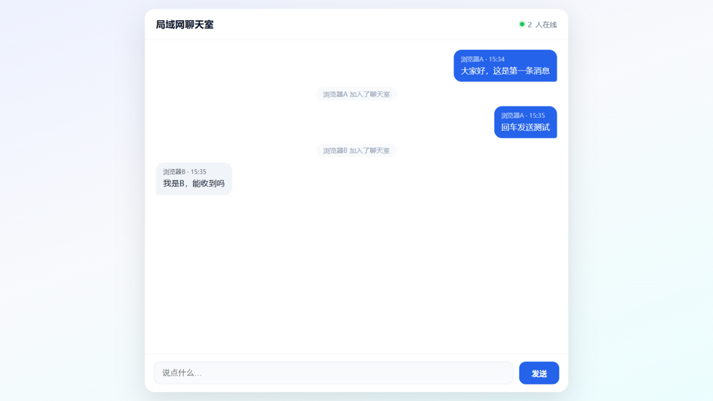

# 局域网聊天室

一个用 **FastAPI + WebSocket** 写的极简聊天室：一台电脑当服务器，同一局域网内的电脑或手机用浏览器打开网页就能聊天。代码量很小，适合 Web 开发入门阅读和练手。



## 特性

- 一台电脑启动服务，局域网内所有人用浏览器访问，无需安装客户端
- 消息实时广播（WebSocket 长连接，不是轮询）
- 新加入的人能看到最近 100 条历史消息
- 显示在线人数、加入 / 离开提示
- 自己的消息在右侧，别人的在左侧
- 中文输入法选词时按回车不会误发送
- 前端零依赖，不引入任何框架

## 快速开始

需要 Python 3.10+，推荐使用 [uv](https://github.com/astral-sh/uv)。

```bash
git clone https://github.com/<your-name>/lan-chat-room.git
cd lan-chat-room

uv venv --python 3.11
uv pip install -r requirements.txt
python main.py
```

没有 uv 的话，用 pip 也可以：

```bash
python -m venv .venv
# Windows: .venv\Scripts\activate
# macOS/Linux: source .venv/bin/activate
pip install -r requirements.txt
python main.py
```

Windows 用户也可以直接双击 `start.bat`，它会自动找到 `.venv` 并启动。

启动后终端会打印：

```
  聊天室已启动
  本机浏览器打开   http://127.0.0.1:9999
  局域网其他人打开 http://192.168.1.220:9999
```

把第二个地址发给同一局域网的人即可。

## 局域网访问说明

| 谁 | 打开哪个地址 |
| --- | --- |
| 服务器本机 | `http://127.0.0.1:9999` |
| 同局域网的其他设备 | `http://<本机局域网IP>:9999` |

- 服务器监听 `0.0.0.0:9999`，所以局域网可达
- **必须在同一个路由器 / WiFi 下**，手机用移动数据流量打不开
- **Windows 防火墙**需要放行 TCP 9999。首次运行时若弹出防火墙提示，勾选"专用网络"并允许；也可以手动加一条入站规则
- 部分路由器的"访客网络"开启了 AP 隔离，设备之间无法互访，请连接主 WiFi

## 项目结构

```
chat-room/
├── main.py            # 后端：HTTP 页面 + WebSocket 广播
├── static/
│   └── index.html     # 前端：页面结构、样式、JS 全在这一个文件
├── docs/
│   └── screenshot.png # 界面截图
├── requirements.txt   # 依赖：fastapi、uvicorn[standard]
├── start.bat          # Windows 一键启动
└── LICENSE            # MIT
```

## 工作原理

```
浏览器 A ──┐
浏览器 B ──┼── WebSocket ──> FastAPI 服务器 ──> 广播给所有在线连接
浏览器 C ──┘
```

1. 浏览器访问 `/`，服务器返回 `static/index.html`
2. 页面用 `new WebSocket(...)` 连接 `/ws`，这是一条保持不断开的长连接
3. 浏览器先发送加入消息，服务器把这条连接记进在线名单
4. 任何人发消息，服务器遍历在线名单，把同一条消息发给所有人
5. 新加入的人会先收到最近 100 条历史消息

### 消息协议

| 方向 | 消息 | 说明 |
| --- | --- | --- |
| 客户端 → 服务器 | `{"type": "join", "name": "小明"}` | 加入，必须是第一帧 |
| 客户端 → 服务器 | `{"type": "message", "text": "你好"}` | 发消息 |
| 服务器 → 客户端 | `{"type": "history", "messages": [...]}` | 历史消息 |
| 服务器 → 客户端 | `{"type": "message", "name": "...", "text": "...", "time": "15:30"}` | 某人发的消息 |
| 服务器 → 客户端 | `{"type": "system", "text": "小明 加入了聊天室"}` | 系统提示 |
| 服务器 → 客户端 | `{"type": "online", "count": 3}` | 在线人数 |

限制：昵称最长 20 字符，消息最长 500 字符，历史上限 100 条。

## 常见问题

**别人打不开？**

1. 确认在同一局域网，地址以 `http://` 开头并带端口号
2. 检查 Windows 防火墙是否放行 9999
3. 换掉访客网络 / 关闭路由器的 AP 隔离
4. 本机 IP 可能变化，以启动时打印的为准

**端口被占用？**

修改 `main.py` 顶部的 `PORT`，同时记得在防火墙里放行新端口。

**重启后消息没了？**

消息只保存在内存里，这是教学版的简化。想持久化可以接入 SQLite。

**能支持多少人？**

每个在线用户占一条 WebSocket 连接，几十人规模没问题。

## 可以继续练的方向

- 消息持久化到 SQLite
- 发送图片（前端读取文件转 base64）
- 昵称去重
- "正在输入…"提示
- 房间 / 私聊

## License

[MIT](LICENSE)
